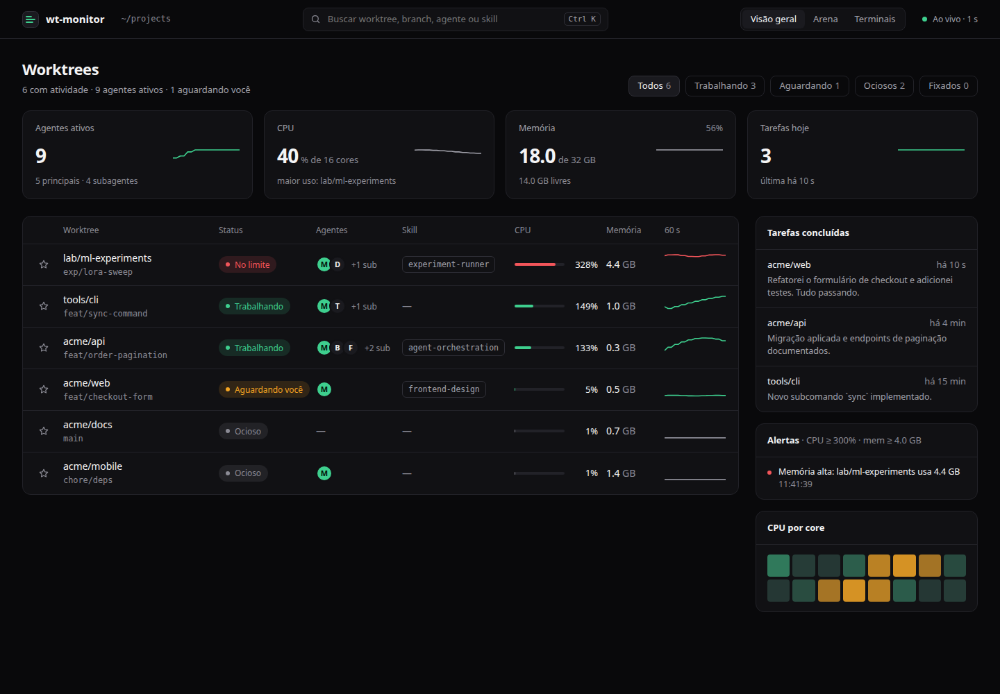
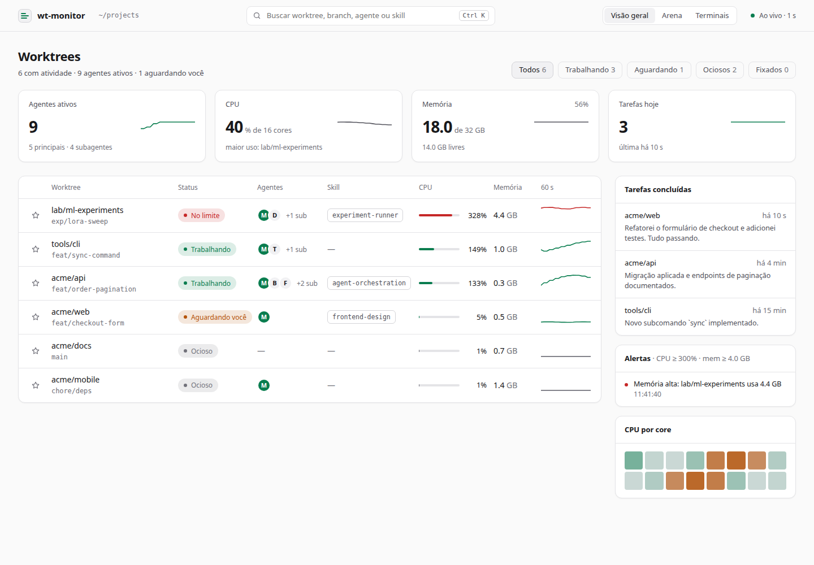
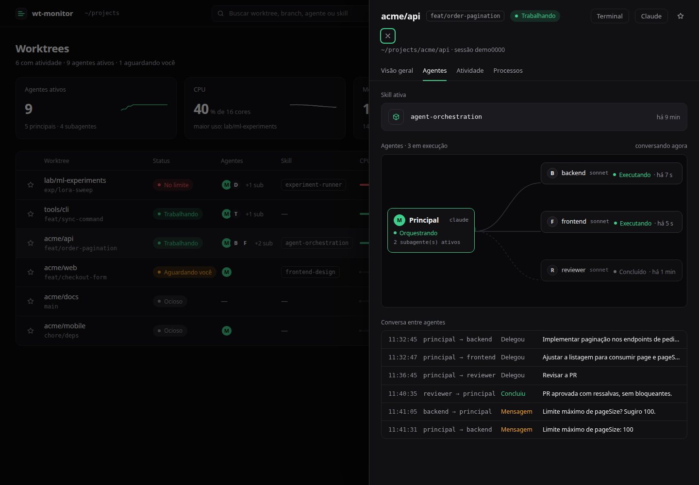
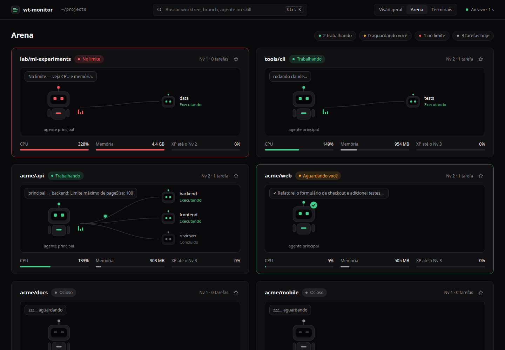
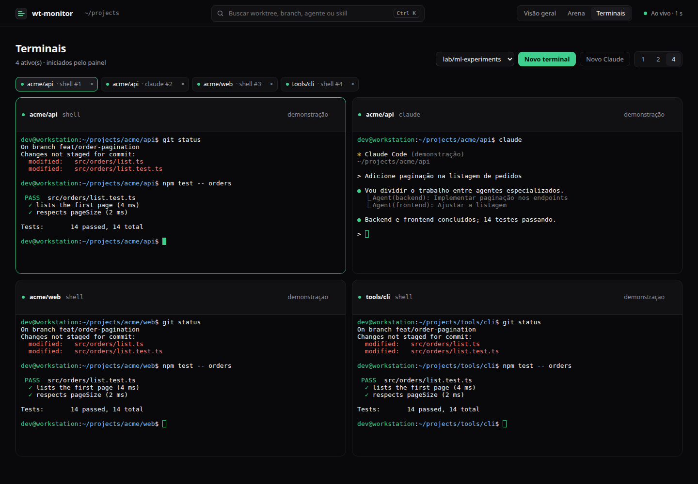

# wt-monitor

A small local dashboard that shows **what each of your Git worktrees is doing**: CPU, memory, threads, CPU affinity and — if you use [Claude Code](https://claude.com/claude-code) — what each agent session is working on and when it finishes a task.

Single static binary, **zero dependencies** (Rust standard library only), Linux only (it reads `/proc`). The UI is one HTML file embedded in the binary.

> 🇧🇷 [Leia em português](README.pt-BR.md)

| Overview (dark) | Overview (light) |
|---|---|
|  |  |

| Session detail: agents, skill and who is talking to whom | Arena (the playful view) |
|---|---|
|  |  |

| Terminals started by the panel (opt-in), four side by side |
|---|
|  |

## Features

- **Per-worktree view** – processes are grouped by the nearest directory containing `.git` (a file in linked worktrees, a folder in normal repos). Branch, status, CPU %, memory, threads, CPU affinity, and 60 s history charts.
- **Agents, skills and sub-agents** – for Claude Code worktrees it shows which agents are running (the main agent plus each running sub-agent with its type and model), the **skill** in use, the tool each sub-agent is on, and **who is talking to whom** (delegations, `SendMessage`, completions). A status is derived for each worktree: *working*, *waiting for you*, *idle* or *at the limit* (see [How status is derived](docs/architecture.md#status)).
- **Session detail** – click a worktree to open a drawer with tabs: overview, agents (topology + conversation between agents), live activity feed (prompts, agent messages, tool calls, results) and processes.
- **Two looks, one switch** – *Overview*, a dense table in the style of modern dashboards (dark and light, follows your system), and *Arena*, where each worktree is a small robot with its sub-agents wired to it and message packets travelling between them. It types when busy, sleeps when idle, celebrates when a task finishes, and earns XP/levels. Respects `prefers-reduced-motion`.
- **Terminals (opt-in)** – open real terminals — a login shell, or `claude` — inside the dashboard, grouped by worktree and shown 1, 2 or 4 at a time. Only terminals **started by the panel** are managed. See [Terminals](#terminals-opt-in).
- **Filters, search and pins** – filter by status, search by worktree, branch, agent or skill (`Ctrl K`), and ★ pin the worktrees you care about; they stay on top even with no running processes.
- **Desktop notifications** (via `notify-send`) for high CPU / memory in a worktree, high system memory, and **when an agent finishes a task**, including its last message.
- **Per-core CPU bars**, system memory and load.

## Quick start

Requirements: Linux, a Rust toolchain (`cargo`), and `notify-send` (package `libnotify-bin`) for notifications.

```bash
git clone https://github.com/patrezelopes/wt-monitor && cd wt-monitor
make run                                # watches ~/dev on port 8765
make run ROOT=~/code PORT=9000          # or choose the root directory and port
```

Open <http://127.0.0.1:8765> (`make open`). To try the UI with fake data, add `?demo` — e.g. <http://127.0.0.1:8765/?demo&mode=fun>.

Everything is a `make` target — see [Make targets](#make-targets) or run `make help`.

### Start at login (systemd user service)

```bash
make install            # builds, installs to ~/.local/bin and enables + starts the user service
make status             # is it running?   (make logs to follow the logs)
make linger             # optional: start at boot, before you log in
```

`make install ROOT=~/code PORT=9000` bakes a different root/port into the unit. Remove it with `make uninstall`.

## Agent notifications (Claude Code hook)

Claude Code can run a command when an agent finishes responding (the `Stop` hook). `hook/wt-agent-hook` posts the agent's last message to the dashboard, which shows it and raises a notification.

```bash
make hooks                              # all of ~/.claude and ~/.claude-*  (idempotent)
make hooks CONFIG_DIRS=~/.claude        # or only specific config dirs
make hook-test                          # fake "task finished" event, to see it work
make hooks-uninstall                    # remove it again
```

It copies the script to `~/.local/bin/wt-agent-hook` and adds a `Stop` hook to each `settings.json`, saving a `settings.json.bak-wt-monitor` backup first. Already-open Claude sessions may need a restart to pick the hook up. If the dashboard is not running the hook exits silently and never blocks the agent. See [docs/agent-hook.md](docs/agent-hook.md).

## Configuration

Command line: `wt-monitor [root=~/dev] [port=8765]` (or `ROOT=`/`PORT=` with `make`). Alert thresholds are environment variables (set them with `Environment=` in the systemd unit):

| Variable | Default | Meaning |
|---|---|---|
| `WT_CPU_PCT` | `300` | Worktree CPU alert threshold (100 = one core) |
| `WT_CPU_SECS` | `20` | Seconds above the CPU threshold before alerting |
| `WT_MEM_GB` | `4` | Worktree memory alert threshold (sum of RSS) |
| `WT_SYS_MEM_PCT` | `90` | System memory usage alert threshold |

Each alert fires once, re-arms when the value returns to normal, and waits at least 2 minutes before repeating. The hook honours `WT_PORT` if you changed the port.

URL parameters: `?mode=sober|fun`, `?theme=dark|light`, `?demo`, and with `?demo` also `?open=<worktree name>&tab=agents|activity|procs|overview`.

## Terminals (opt-in)

The dashboard can run terminals itself. This is **off by default**: it lets a web page start shells as you, so read [SECURITY.md](SECURITY.md) first.

```bash
make run TERMINALS=1          # or: wt-monitor --terminals   (WT_TERMINALS=1 also works)
make install TERMINALS=1      # same, as the systemd user service
make open-terminals           # opens the dashboard with the one-time token in the link
```

A random 256-bit secret is created on first use in `~/.config/wt-monitor/token` (mode `0600`) and is never returned by the API. `make open-terminals` opens `http://127.0.0.1:8765/#token=…` once; the browser remembers the token (the fragment is never sent to the server) and the link is cleaned from the address bar. Without the token the *Terminals* tab explains how to get it and its buttons stay disabled.

- **Tab "Terminais"**: pick a worktree and click *Novo terminal* (a login shell in that worktree, so your `PATH`, `nvm` and per-folder account switching apply; it falls back to `/bin/bash` when `$SHELL` is not set, as in systemd user services) or *Novo Claude* (the same shell, with `claude` already typed). The session drawer has the same two buttons.
- **Sets**: terminals are grouped by worktree in tabs; the `1 / 2 / 4` switch shows that many side by side. Closing a tab kills the terminal's process group.
- **Reconnect**: terminals live in the server, not in the page. Reload or reopen the browser and they come back with the last 256 KB of output; ended terminals stay listed for 10 minutes with their exit code. At most 16 run at once.
- Only terminals **started by the panel** are managed; it never attaches to terminals you opened elsewhere.

The PTY and the WebSocket are implemented with the standard library only (no crates); the terminal emulator is [xterm.js](vendor/xterm/README.md), embedded in the binary.

## Make targets

`make` with no arguments prints this list. Variables you can override: `ROOT` (default `~/dev`), `PORT` (`8765`), `PREFIX` (`~/.local`), `TERMINALS` (`1` enables terminals), `CONFIG_DIRS` (Claude config dirs for the hook; default all).

| Target | What it does |
|---|---|
| `make build` | Build the optimized binary |
| `make run` | Run in the foreground on `ROOT`/`PORT` (`TERMINALS=1` enables terminals) |
| `make open-terminals` | Open the dashboard with the one-time terminal token in the link |
| `make open` | Open the dashboard in the default browser |
| `make test` | Unit tests |
| `make fmt` / `make fmt-check` | Format / check formatting |
| `make lint` | `clippy`, warnings are errors |
| `make js-check` | Syntax-check the page script (needs `node`) |
| `make check` | `fmt-check`, `lint`, `test`, `js-check` |
| `make e2e` | End-to-end tests of the terminals, over HTTP/WebSocket and in a real headless Chrome (CI runs `check` and `e2e`) |
| `make install` | Build, install to `PREFIX/bin`, enable + (re)start the systemd user service |
| `make uninstall` | Stop and remove the service and binary |
| `make restart` / `status` / `logs` | Manage the service (`logs` follows `journalctl`) |
| `make linger` | Start the service at boot, before you log in |
| `make hooks` | Install the Claude Code `Stop` hook (backs up each `settings.json`) |
| `make hooks-uninstall` | Remove the hook again |
| `make hook-test` | Send a fake "task finished" event to the running dashboard |
| `make screenshots` | Regenerate `docs/img/*.png` from demo data (needs Chrome) |
| `make clean` | Remove build artifacts |

## Pinning each worktree to its own CPU cores

The dashboard shows affinity; setting it is a one-liner, and children inherit it:

```bash
cd ~/dev/wt-a && taskset -c 0,1 claude
cd ~/dev/wt-b && taskset -c 2,3 claude
# or with a cgroup:  systemd-run --user --scope -p AllowedCPUs=2-3 bash -c 'cd ~/dev/wt-b && claude'
```

Build tools size their worker pools from the machine's CPU count, not from affinity — also cap them (`make -j2`, `jest --maxWorkers=2`).

## Security & privacy

- Terminals, when enabled, are guarded by a token that is never exposed by the API, `Origin`/`Host` checks and a closed set of commands — details and threat model in [SECURITY.md](SECURITY.md).
- Listens on **127.0.0.1 only** and rejects any `Host` header other than `127.0.0.1:<port>` / `localhost:<port>` (DNS-rebinding protection).
- `POST /event` requires the custom header `X-WT: 1`, which forces a CORS preflight, so other web pages in your browser cannot inject fake events.
- The preview and agent views read Claude Code transcripts (and sub-agent transcripts) under `~/.claude*/projects/` **only for worktrees inside the watched root**; the requested path is validated and never used to read arbitrary files. Transcripts can contain sensitive content — the preview is as private as your loopback interface.
- Pins and XP are stored in your browser's `localStorage`; nothing is sent anywhere.
- Per-process details come from `/proc/<pid>/{cwd,stat,status,cmdline}`, so you only see processes you are allowed to inspect (your own).

## How it works

See [docs/architecture.md](docs/architecture.md).

## Limitations

Linux only. Terminals run your login shell and are limited to 16; they do not attach to sessions you started elsewhere. Memory is the sum of RSS, so pages shared between processes are counted more than once. Task detection relies on Claude Code's `Stop` hook, which fires after *every* completed response, not only long tasks. Agent, skill and *waiting for you* detection is **inferred from the transcript files** (their format is not a stable API) and is a best-effort heuristic. The UI uses Inter / JetBrains Mono when installed and falls back to system fonts; it makes no network requests.

## Contributing & license

PRs welcome — see [CONTRIBUTING.md](CONTRIBUTING.md). Licensed under the [MIT License](LICENSE).
