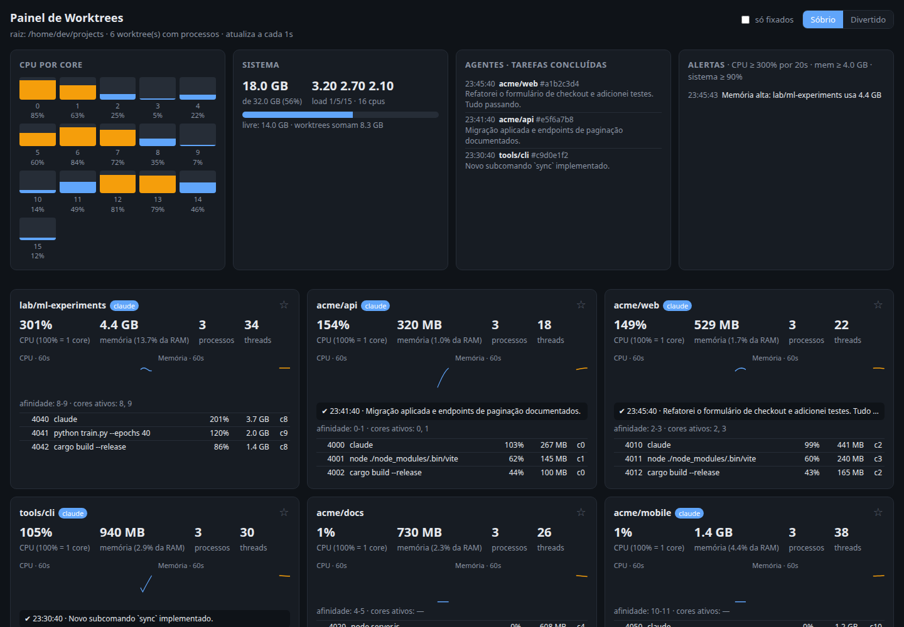
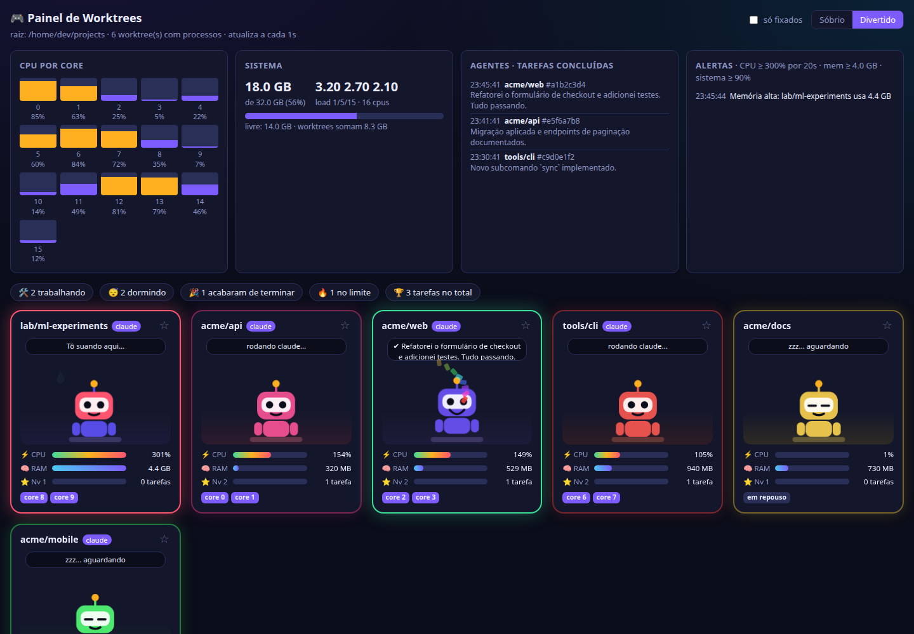
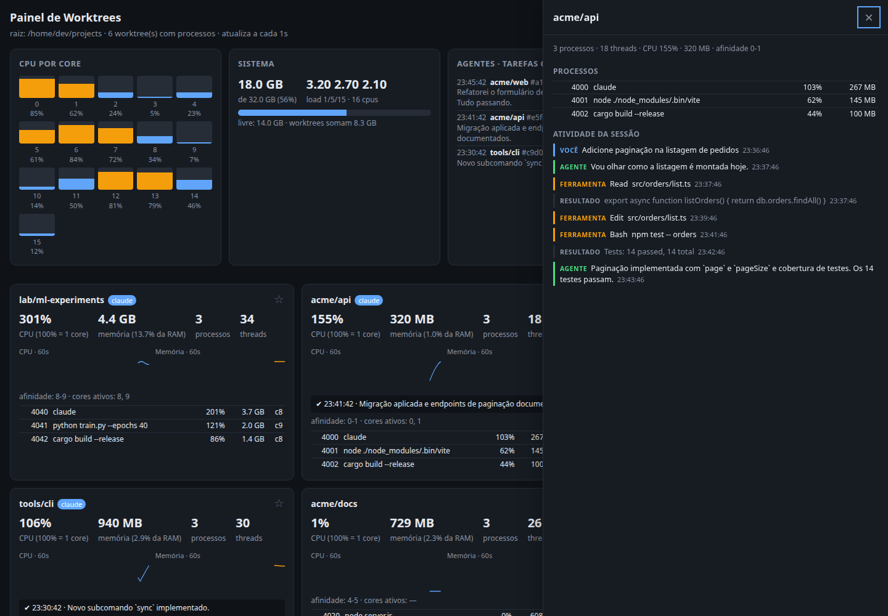

# wt-monitor

A small local dashboard that shows **what each of your Git worktrees is doing**: CPU, memory, threads, CPU affinity and — if you use [Claude Code](https://claude.com/claude-code) — what each agent session is working on and when it finishes a task.

Single static binary, **zero dependencies** (Rust standard library only), Linux only (it reads `/proc`). The UI is one HTML file embedded in the binary.

> 🇧🇷 [Leia em português](README.pt-BR.md)

| Sober view | Playful view |
|---|---|
|  |  |

## Features

- **Per-worktree view** – processes are grouped by the nearest directory containing `.git` (a file in linked worktrees, a folder in normal repos). CPU %, memory, threads, CPU affinity, the core each process last ran on, and 60 s history charts.
- **Session preview** – click a worktree to open a drawer with its processes and the live activity feed of the latest Claude Code session in it (prompts, agent messages, tool calls and results).
- **Two looks, one switch** – a sober dashboard, and a playful one where each worktree is a little robot: it types when busy, sleeps when idle, celebrates when a task finishes, sweats when over a limit, and earns XP/levels per completed task. Respects `prefers-reduced-motion`.
- **Pins** – ★ the worktrees you care about; they stay on top (even with no running processes) and a "pinned only" filter hides the rest.
- **Desktop notifications** (via `notify-send`) for high CPU / memory in a worktree, high system memory, and **when an agent finishes a task**, including its last message.
- **Per-core CPU bars**, system memory and load.



## Quick start

Requirements: Linux, a Rust toolchain (`cargo`), and `notify-send` (package `libnotify-bin`) for notifications.

```bash
git clone https://github.com/patrezelopes/wt-monitor && cd wt-monitor
cargo run --release -- ~/dev 8765      # root directory to watch, port
```

Open <http://127.0.0.1:8765>. Try the UI without the server (fake data): `index.html` is served at `/`, add `?demo` — e.g. <http://127.0.0.1:8765/?demo&mode=fun>.

### Start at login (systemd user service)

```bash
./install.sh            # builds, installs to ~/.local/bin and enables the user service
systemctl --user status wt-monitor
```

To start at boot, before you log in: `loginctl enable-linger $USER`.

## Agent notifications (Claude Code hook)

Claude Code can run a command when an agent finishes responding (the `Stop` hook). `hook/wt-agent-hook` posts the agent's last message to the dashboard, which shows it and raises a notification.

```bash
python3 install-hooks.py                # all of ~/.claude, ~/.claude-*  (idempotent)
python3 install-hooks.py ~/.claude      # or only specific config dirs
```

It copies the script to `~/.local/bin/wt-agent-hook` and adds a `Stop` hook to each `settings.json`, saving a `settings.json.bak-wt-monitor` backup first. Already-open Claude sessions may need a restart to pick the hook up. If the dashboard is not running the hook exits silently and never blocks the agent. See [docs/agent-hook.md](docs/agent-hook.md).

## Configuration

Command line: `wt-monitor [root=~/dev] [port=8765]`. Alert thresholds are environment variables (set them with `Environment=` in the systemd unit):

| Variable | Default | Meaning |
|---|---|---|
| `WT_CPU_PCT` | `300` | Worktree CPU alert threshold (100 = one core) |
| `WT_CPU_SECS` | `20` | Seconds above the CPU threshold before alerting |
| `WT_MEM_GB` | `4` | Worktree memory alert threshold (sum of RSS) |
| `WT_SYS_MEM_PCT` | `90` | System memory usage alert threshold |

Each alert fires once, re-arms when the value returns to normal, and waits at least 2 minutes before repeating. The hook honours `WT_PORT` if you changed the port.

URL parameters: `?mode=sober|fun`, `?demo`, `?open=<worktree name>` (with `?demo`).

## Pinning each worktree to its own CPU cores

The dashboard shows affinity; setting it is a one-liner, and children inherit it:

```bash
cd ~/dev/wt-a && taskset -c 0,1 claude
cd ~/dev/wt-b && taskset -c 2,3 claude
# or with a cgroup:  systemd-run --user --scope -p AllowedCPUs=2-3 bash -c 'cd ~/dev/wt-b && claude'
```

Build tools size their worker pools from the machine's CPU count, not from affinity — also cap them (`make -j2`, `jest --maxWorkers=2`).

## Security & privacy

- Listens on **127.0.0.1 only** and rejects any `Host` header other than `127.0.0.1:<port>` / `localhost:<port>` (DNS-rebinding protection).
- `POST /event` requires the custom header `X-WT: 1`, which forces a CORS preflight, so other web pages in your browser cannot inject fake events.
- The preview reads Claude Code transcripts under `~/.claude*/projects/` **only for worktrees inside the watched root**; the requested path is validated and never used to read arbitrary files. Transcripts can contain sensitive content — the preview is as private as your loopback interface.
- Pins and XP are stored in your browser's `localStorage`; nothing is sent anywhere.
- Per-process details come from `/proc/<pid>/{cwd,stat,status,cmdline}`, so you only see processes you are allowed to inspect (your own).

## How it works

See [docs/architecture.md](docs/architecture.md).

## Limitations

Linux only. Memory is the sum of RSS, so pages shared between processes are counted more than once. Task detection relies on Claude Code's `Stop` hook, which fires after *every* completed response, not only long tasks.

## Contributing & license

PRs welcome — see [CONTRIBUTING.md](CONTRIBUTING.md). Licensed under the [MIT License](LICENSE).
